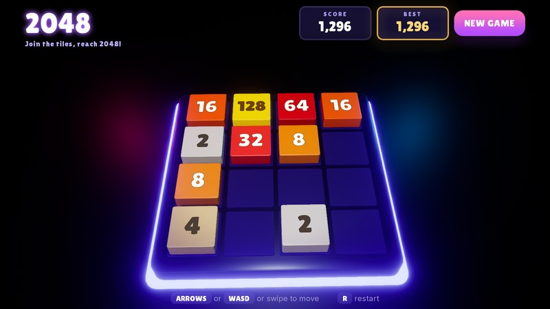
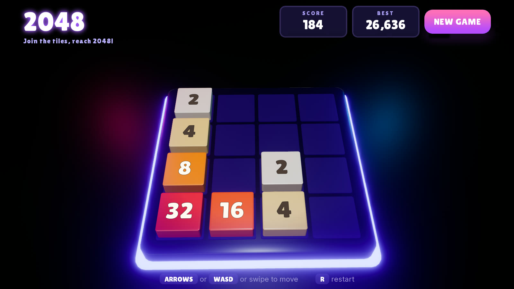
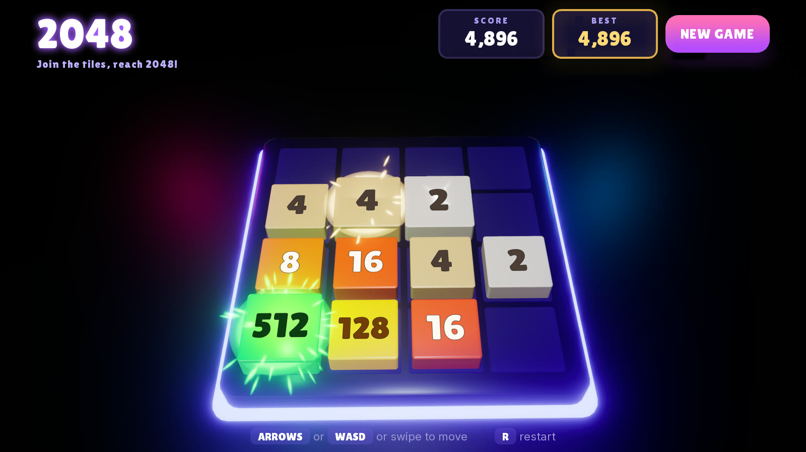
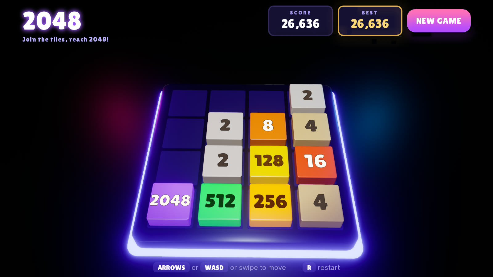
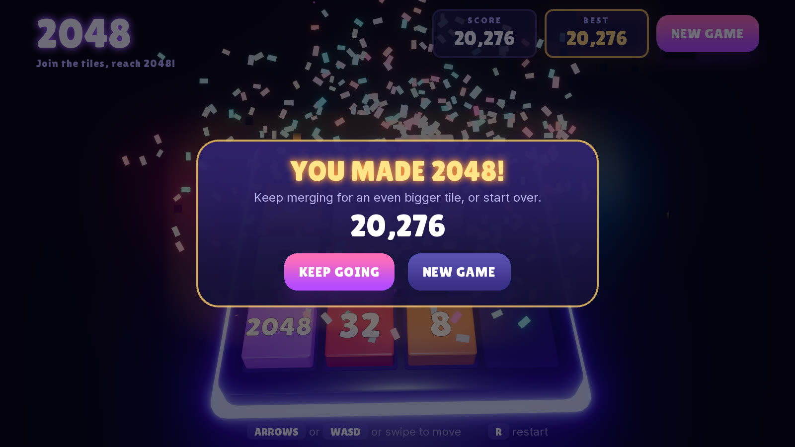
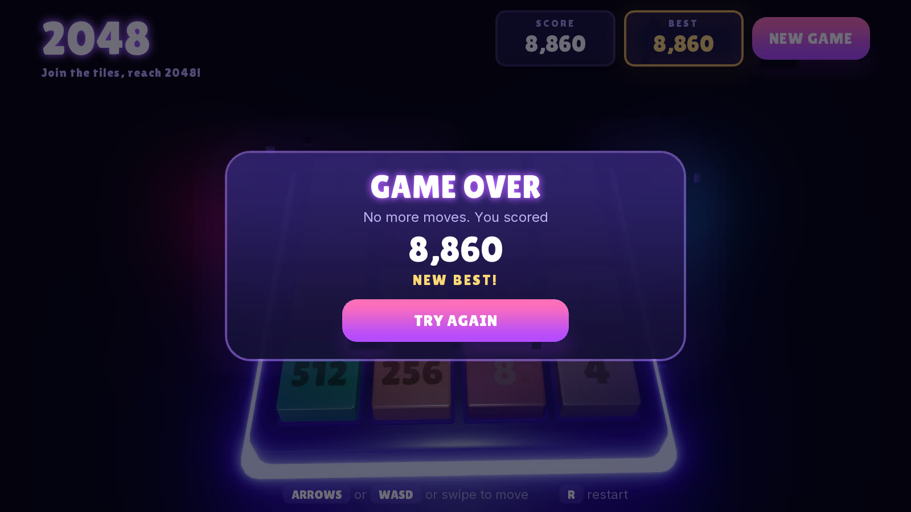

# 2048

The sliding tile puzzle on a glowing 3D board: slide the tiles, merge equal numbers and reach 2048. The best score
is kept between sessions. A sample project for [Unravel Engine](https://github.com/unravel-dev/UnravelEngine).

The sample is small on purpose: seven scripts, one scene and one HUD document that together make a finished casual
game for desktop, phones and the browser.

## Play

Clone this repository, or get it from the Samples page of the Unravel editor's start page, and open its folder in
the editor. Open `data/Scenes/Main.spfb` and press Play.

| Action | Keyboard and mouse | Gamepad | Touch |
|---|---|---|---|
| Slide the tiles | Arrows / WASD | D-pad | Swipe |
| New game | R, New Game button | - | New Game button |
| Keep playing after 2048 | Keep Going button | - | Keep Going button |

## What it shows

- **Input actions**: Move Up / Down / Left / Right and Restart in the project's action maps, plus a swipe read from
  the pointer, scaled by the screen's DPI (`Game2048.cs`).
- **Pooled prefabs**: every tile is an instance of `Prefabs/Tile.pfb` taken from and returned to an `EntityPool`.
- **Motion with coroutines**: slides, merge pops, drops and the board clearing on a new game run as coroutines with
  hand-written easing (`Ease.cs`), so the rules (`Board.cs`) stay free of timing.
- **Feedback**: sparks, a ring, a flash and a point light on every merge, merge sounds pitched by tile value, and a
  camera that sweeps in, sways and shakes (`CameraRig.cs`).
- **UI bound to C#**: the HUD (`UI/Hud.rhtml`) reads the data model `hud` (`HudModel.cs`) for the scores and the win
  and game-over panels; its buttons call back into the game.
- **Save data**: the best score is a file in `Application.persistentDataPath` (`SaveData.cs`), the per-user folder
  the engine gives every game on desktop and Android.
- **Look**: emissive tiles and an underglowing board, rim lights, a glossy floor with screen-space reflections,
  ambient occlusion, temporal anti-aliasing and bloom.

## Screenshots

| | |
|---|---|
|  |  |
|  |  |
|  | |

## Project layout

| Path | What it holds |
|---|---|
| `data/Scenes/Main.spfb` | The game's one scene: board, camera, lights and the HUD entity. |
| `data/Scripts/Board.cs` | The rules: slides, merges, spawns, win and game over. No engine calls. |
| `data/Scripts/Game2048.cs` | Reads a move, applies it to the board and plays the result on the tile entities. |
| `data/Scripts/TileView.cs` | How each value looks: body colour, glow and digit colour. |
| `data/Scripts/HudModel.cs` | The HUD's data model. |
| `data/Scripts/CameraRig.cs` | Intro sweep, idle sway and shake around the camera's placed pose. |
| `data/Scripts/Ease.cs` | Easing curves. |
| `data/Scripts/SaveData.cs` | Loads and saves the best score. |
| `data/Prefabs/Tile.pfb` | The tile every value uses. |
| `data/UI/Hud.rhtml`, `Hud.rcss` | The HUD: scores, buttons, win and game-over panels. |

## Platforms

| Profile | Notes |
|---|---|
| Desktop | Windows or Linux, as the editor runs on. |
| Android | Phones and tablets, with swipes. |
| Web | The browser player, global illumination off. |
| WebNoPost | The browser player with every post effect off, for phones that need the plain image. |

Deploy from the editor's Deploy window with a profile from `profiles/`.

## Credits

| Asset | Author | License |
|---|---|---|
| Lilita One typeface | Juan Montoreano | SIL Open Font License 1.1 (`data/Fonts/LilitaOne-OFL.txt`) |

The sounds and particle textures were generated for this sample. Code and all other content are under the MIT
license in [LICENSE](LICENSE).
